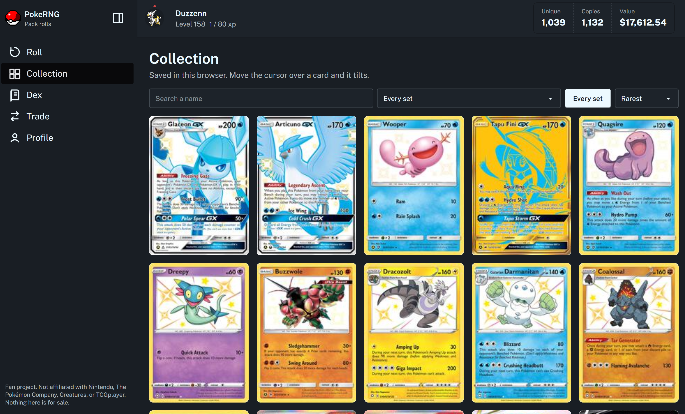

<div id="top" align="center">


<h1><a href="https://poke-rng.vercel.app/" target="_blank">PokemonRNG</a></h1>

<p>
    <a href="https://github.com/davidanukam/PokemonRNG/graphs/contributors">
        
    </a>
    <a href="">
        
    </a>
    <a href="https://github.com/davidanukam/PokemonRNG/network/members">
        
    </a>
    <a href="https://github.com/davidanukam/PokemonRNG/stargazers">
        
    </a>
    <a href="https://github.com/davidanukam/PokemonRNG/issues/">
        
    </a>
    <a href="https://github.com/davidanukam/PokemonRNG/blob/main/LICENSE">
        
    </a>
</p>



</div>

Local archive of the international Pokémon TCG. Card text and the EUR series come from [Limitless](https://limitlesstcg.com/cards). Pictures, the USD price, and the price of each condition come from the [TCGplayer Pokémon price guides](https://www.tcgplayer.com/categories/trading-and-collectible-card-games/pokemon). `pokedex/dex.json` stores each species, each set, and each printing. Daily condition prices also live in `pokedex/tcgplayer.sqlite`.

Why those choices were made is in [DECISIONS.md](DECISIONS.md).

Card text and images are copyright The Pokémon Company, Nintendo, Game Freak, and/or Creatures. This project keeps URLs and the text Limitless already publishes. It does not download the image files.

## Setup

Python 3.13 and the packages in `requirements.txt`:

```text
pip install -r requirements.txt
```

## Commands

Run these from the project root.

```text
python main.py species
python main.py cards --set 30C --limit 1
python main.py cards
python main.py cards --refresh
python main.py tcgplayer --set 30C
python main.py tcgplayer
python main.py predict
python main.py all
python main.py play
```

| Command | What it does |
| --- | --- |
| `species` | Reloads the national dex from `/cards/pokedex` and keeps cards already saved. |
| `cards` | Downloads international sets, card text, prices, and price history. |
| `cards --set CODE` | Limits the download to one set. Repeat the flag for more than one set. |
| `cards --limit N` | Stops after N card pages. |
| `cards --refresh` | Downloads cards again even if they were saved in the last 7 days. |
| `cards --delay 0.3` | Seconds between requests. The default is 0.3. |
| `tcgplayer` | Reads every active Pokémon set in the TCGplayer set dropdown. Saves Near Mint, Lightly Played, Moderately Played, Heavily Played, Damaged, and any other grade, and replaces card images with the TCGplayer scan. |
| `tcgplayer --set 30C` | Limits that read to one set. A code, a price-guide slug, or a TCGplayer set id all work. |
| `tcgplayer --refresh` | Reads a set again even if it was saved in the last 7 days. |
| `tcgplayer --rematch` | Applies the prices already in SQLite onto the dex again. It does not download the guides. |
| `predict` | Fits every forecast again from the history already in the dex. |
| `all` | Runs `species`, then `cards`. |
| `play` | Starts PokeRNG at `http://127.0.0.1:8765/`. The first run installs the site and builds the card pool. |
| `catalog` | Rebuilds `web/public/data/catalog.json` from the SQLite prices. |

## PokeRNG

`python main.py play` starts the Next.js pack site. A roll picks a rarity, then a card of that rarity, then a condition. Commons are 1 in 2. Mythic cards are 1 in 10,000. Damaged drops the shown tier by two and uses the Damaged market price. The collection is saved in the browser. There are no accounts and no payments.

A second run of `cards` skips cards saved in the last 7 days. Set files in `pokedex/sets/` are the checkpoint, so an interrupted run can continue. Progress is written to `pokedex/progress.json`. A second run of `tcgplayer` skips sets saved in the last 7 days. That progress is `pokedex/tcgplayer_progress.json`, and the daily prices are in `pokedex/tcgplayer.sqlite`. Failures are appended to `pokedex/errors.log`.

## Data

`pokedex/dex.json` has three lists:

- `pokemon`: national dex number, sprite URL, name, card count, `card_image`, and `card_ids`.
- `sets`: code, name, series, release date, and card count.
- `cards`: one object per printing.

A card includes `card_image`, supertype, subtypes, types, HP, abilities, attacks, rules, weakness, resistance, retreat, illustrator, regulation, legality, and other prints. `card_image` is the TCGplayer scan once that product has been read. The older Limitless URL stays on `limitless_image`. `prices.usd` is the Near Mint market price (Normal printing when that printing exists). `prices.eur` is the Cardmarket price. `prices.conditions` lists each grade's market price, low price, and recent sales for the headline printing. `prices.printings` repeats that for every printing. `price_history` holds daily points for USD and EUR. `prediction.usd` and `prediction.eur` are linear regressions from scikit-learn, 30 days after the last saved point. A condition forecast is added under `prediction.conditions` after that grade has been saved on two different days. A series with fewer than two points is null. A forecast below zero is stored as 0.

## Add a row

```python
from scraper.pokedex import add_entry

add_entry(number="1", name="Bulbasaur", pixel_image="https://...", amount="23")

add_entry(
    set_code="30C",
    number="1",
    name="Exeggcute",
    card_image="https://...",
    prices={"usd": 0.19, "eur": 0.05},
    price_history={
        "usd": [{"date": "2026-11-06", "price": 0.19}],
        "eur": [{"date": "2026-11-06", "price": 0.05}],
    },
)
```

A species matches on dex number and name. A card matches on set code and collector number. Adding a card fits that card, refits every saved forecast, and writes `pokedex/dex.json`.

## Layout

```text
main.py                 command line
requirements.txt
scraper/pokedex.py      scrape and add_entry
scraper/parse.py        HTML and price JSON
scraper/predict.py      linear regression
scraper/store.py        dex.json and set checkpoints
scraper/http_client.py  rate-limited Limitless requests
scraper/tcgplayer.py    TCGplayer price guides
scraper/tcg_db.py       SQLite price rows
scraper/constants.py    paths and the 30-day horizon
web/                    PokeRNG, the Next.js pack site
pokedex/dex.json        species, sets, and cards
pokedex/tcgplayer.sqlite  daily price by printing and condition
pokedex/sets/           one JSON file per set
DECISIONS.md            decision log
```
